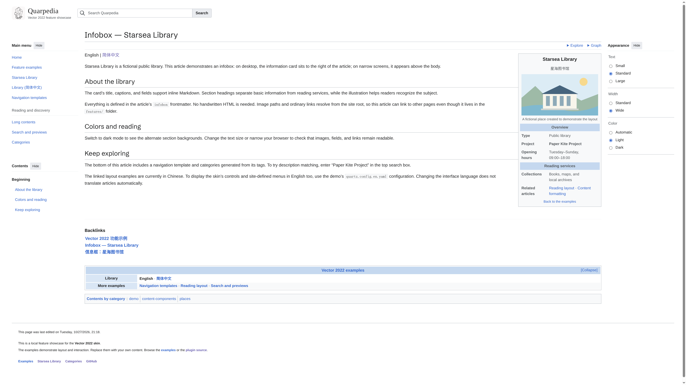

# Quartz Vector 2022 Skin

English | [简体中文](docs/README.zh_CN.md)

A Wikipedia-style layout for Quartz, adapted from [Wikimedia’s Vector skin](https://github.com/wikimedia/mediawiki-skins-Vector). It brings together a top search bar, movable menus, an article contents panel, reading preferences, infoboxes, navigation templates, and categories.



The skin supports the Quartz 5 community plugin system, English and Chinese interfaces, and mobile screens. It handles presentation; MediaWiki features such as accounts, online editing, and revision history need separate implementations.

## Install

Use Node.js 22 or newer and npm 10.9.2 or newer. Run this in your Quartz 5 site directory:

```sh
npx quartz plugin add github:Copartiper/quartz-skin-vector-2022
npx quartz build --serve
```

The installer downloads and builds the plugin, then enables it in `quartz.config.yaml`. You do not need to copy layout files or edit `quartz.ts`. Older Quartz versions without the `quartz plugin` command need an upgrade first. Themes that replace the standard page structure may need manual integration.

Find the installed plugin entry and put your settings under its `options`. Keep your other plugins and edit this entry instead of adding duplicates:

```yaml
plugins:
  - source: github:Copartiper/quartz-skin-vector-2022
    enabled: true
    options:
      locale: en-US
      tagline: Collect, connect, share
```

The skin reuses your existing Quartz search, explorer, and graph components. If one is missing, its entry is hidden. Reading time, breadcrumbs, the native theme button, and Properties are hidden; tags move below the article, and other sidebar widgets move below the body. Your existing footer stays unless you configure a replacement.

These layout changes require JavaScript. The plugin does not change articles or enable and disable other plugins. Set its `enabled` to `false` and rebuild to restore the original layout.

## Set up an English site

Set `configuration.locale: en-US` for Quartz itself and `options.locale: en-US` for this skin. `auto` follows the Quartz locale. Menu labels, navigation templates, footer text, and articles are your own content: translate those fields separately.

[examples/vector.en.yaml](examples/vector.en.yaml) provides an English plugin entry with branding, navigation, reading defaults, and a Markdown footer. Merge it into your existing configuration; it is a configuration example, not a complete replacement for your site’s plugin list. A matching Chinese configuration is available in [examples/vector.cn.yaml](examples/vector.cn.yaml).

## Branding and the main menu

```yaml
plugins:
  - source: github:Copartiper/quartz-skin-vector-2022
    enabled: true
    options:
      locale: en-US
      wordmark: My Knowledge Base
      tagline: Collect, connect, share
      logoUrl: static/icon.png
      logoAlt: My Knowledge Base logo
      navigation:
        - label: Home
          href: index
        - label: Categories
          href: tags/
        - section: Community
          label: About this site
          href: about
```

`wordmark` defaults to Quartz’s `pageTitle`. `tagline` appears below it. An empty `logoUrl` hides the image. `homeUrl` can override the branding link; it otherwise points to the site root.

Each navigation item has a `label` and `href`. An optional `section` adds a heading before that item. Supplying `navigation` replaces the entire default menu, which contains Home and Categories; `navigation: []` clears it.

Use site-root-relative page paths such as `about` or `notes/example`, without `.md`. They work from nested articles too. External links use full HTTPS URLs. Menu entries do not create pages, so make sure their destinations exist.

## Menus and reading preferences

Readers can move the main menu and contents into the left sidebar, and Explore into the right sidebar below Appearance. Hiding a panel returns it to its button. Appearance opens from the glasses button at the top right when hidden.

Standard width reserves both sidebars, keeping the article in place when menus are hidden. Wide width fills the browser and gives unused sidebar space to the article. Below 1120 px, all four panels open from buttons and sidebar space disappears. Articles without sections have no contents panel. A floating contents button appears at the top left when the original entry scrolls out of view.

```yaml
options:
  defaultTheme: auto # auto, light, or dark
  defaultTextSize: standard # small, standard, or large
  defaultWidth: standard # standard or wide
  showAppearance: true
```

These are initial defaults. The browser remembers the reader’s own choices and uses them first.

The contents panel follows heading levels. Up to 28 headings are expanded initially; longer articles start with subsections collapsed. Following a section link expands its parents. Scrolling updates the active section without changing the expansion state.

Two round buttons at the bottom right jump to the page top and bottom. They appear while scrolling down after the article title leaves the viewport, and hide when scrolling up or returning to the title. They also work on mobile.

Escape closes a floating menu and returns focus to its button. Only one floating menu opens at a time. Search suggestions support arrow-key selection and keep the selected result visible.

Top-bar search first matches titles and descriptions. The final “Search for pages containing…” option opens Quartz’s full-text search with page previews. The query is bold in that option. Link and search previews hide the site header to focus on article content.

These details draw on MediaWiki’s [Desktop Improvements](https://www.mediawiki.org/wiki/Reading/Web/Desktop_Improvements), [updates](https://www.mediawiki.org/wiki/Reading/Web/Desktop_Improvements/Updates), and [Vector 2022 design documentation](https://www.mediawiki.org/wiki/Skin:Vector/2022/Design_documentation), adapted to Quartz.

## Write the footer

Use Markdown for the body and `footerLinks` for the final link row:

```yaml
options:
  revisionTimeZone: Europe/London
  footerMarkdown: |
    Text is available under our **[license](https://example.org/license)**.

    Please read the [terms of use](usage).
  footerLinks:
    - label: About
      href: about
    - label: Contact
      href: contact
```

Footer text and links follow the article colors, with no separate solid background. The last-revised timestamp appears above the footer body. It uses the article’s latest Git commit; uncommitted changes use the local file modification time.

You can override footer text colors for each theme:

```yaml
footerTextColors:
  light: "var(--qv-fg)"
  dark: "var(--qv-fg)"
```

Values may be hex colors or CSS custom properties. `var(--qv-fg)` is the article text color. The older `footerParagraphs` option still accepts arrays of paragraphs containing `{ text, href?, bold? }` objects. `footerMarkdown` takes precedence when both are supplied.

## Add an infobox

Add an `infobox` to an article’s YAML frontmatter. It floats to the right on desktop and sits above the body on narrow screens. Articles without one are unaffected.

```yaml
---
title: Starsea Library
infobox:
  title: Starsea Library
  subtitle: A place to read and discover
  image: static/icon.png
  imageAlt: Library logo
  caption: The library emblem
  color:
    light: "#c5d8ef"
    dark: "#293e57"
  rows:
    - heading: Overview
    - label: Type
      content: Public library
    - label: Location
      content: "[Example City](places/example)"
    - heading: Services
    - label: Collections
      content: "**Books, maps, and local archives**"
  below: "See [related articles](related)"
---
```

`title` and `rows` are required. Other fields are optional. A row is either a `heading`, or a `label` and `content` pair. Text fields support inline Markdown; raw HTML is escaped. Ordinary image and Markdown link paths resolve from the site root; full HTTPS URLs also work. Provide meaningful `imageAlt` text for informative images. Theme colors accept hex values and control section backgrounds.

Manual layouts can place the exported `VectorInfobox()` at the start of the article. Standard installation does this automatically.

## Add navigation templates

Navigation templates group related links below an article. Define a shared template once under plugin options:

```yaml
options:
  navigationTemplates:
    - title: "[My Knowledge Base](index)"
      collapsed: false
      color:
        light: "#c5d8ef"
        dark: "#293e57"
      rows:
        - label: Getting started
          content: "[About](about) · [Guide](guide)"
        - label: More
          content: "[FAQ](faq) · [Contact](contact)"
      below: "[Categories](tags/)"
```

Select it in an article:

```markdown
---
title: Guide
navboxes: [0]
---

Your article goes here.
```

Indexes start at zero. `navboxes: [0, 1]` displays the first two templates in that order. Articles without `navboxes` show none. You can also put template objects directly in article frontmatter or mix them with indexes; see [EXAMPLES.md](EXAMPLES.md) for examples in Chinese.

| Field                       | Purpose                                       |
| --------------------------- | --------------------------------------------- |
| `title`                     | Template heading, optionally linked           |
| `collapsed`                 | Whether the template starts collapsed         |
| `color.light`, `color.dark` | Hex heading colors for each theme             |
| `rows`                      | Groups with `label` and Markdown `content`    |
| `above`, `below`            | Optional content above and below the groups   |
| `links`                     | Optional action links with `label` and `href` |

Group backgrounds are derived from the heading colors. Omit colors to use the defaults. Text supports inline Markdown. Links to the current article become bold plain text automatically.

## Categories

Categories use normal Quartz tags:

```yaml
---
title: Example article
tags: [Knowledge, Getting started]
---
```

They appear in a category row at the bottom of the article. No tags means no category row.

## Update, disable, or migrate

To update from GitHub:

```sh
npx quartz plugin install quartz-skin-vector-2022 --latest
npx quartz build
```

Save your configuration and article changes before updating. Restart a running preview server after the update.

To disable the skin, set its plugin entry’s `enabled` to `false` and rebuild. You can keep the configuration and article template definitions for later.

If you previously installed the skin manually, remove duplicate Vector components and the search index emitter from `quartz.ts` or your layout first. Move settings from the old `vectorSkin` block into the plugin entry’s `options`. Automatic installation does not read the old block or overwrite layout files.

## Manual layouts

Automatic installation uses `VectorPage` to place the skin in standard Quartz pages. For custom layouts, `VectorSkin(options)` returns these components:

| Component    | Purpose                                                     |
| ------------ | ----------------------------------------------------------- |
| `header`     | Top bar, styles, and browser scripts; include once per page |
| `toc`        | Article contents, using Quartz’s heading data               |
| `appearance` | Reading preferences                                         |
| `navigation` | Navigation templates below the article                      |
| `revision`   | Revision timestamp from `dates.modified`                    |
| `footer`     | Markdown footer and link row                                |

Components are also individually exported. With manual integration, arrange search and categories yourself and add `VectorSearchIndex()` to the emitters. Do not combine manual components with automatic `VectorPage` integration. [ARCHITECTURE.md](ARCHITECTURE.md) describes the source layout in Chinese; public option types are in [src/types.ts](src/types.ts).

## Development

```sh
npm run check        # Types, lint, formatting, and unit tests
npm run build
npx playwright install chromium # Once, before browser tests
npm run test:browser
QUARTZ_HOST=/path/to/quartz npm run test:install
npm run test:performance
```

Browser tests leave a preview and screenshots in `quartz-vector-preview/` under the system temporary directory. Installation tests create an isolated site and copy plugin source for the installer to build; they do not modify the supplied Quartz host.

Performance tests measure first rendering of 100 pages, repeated cached rendering, and Git process counts. Browser tests also check heading measurements during scrolling and contents highlighting after layout changes. [PERFORMANCE.md](PERFORMANCE.md) records measurements and their limits in Chinese. Build and inspect your own site after installation too.

## Credits and license

Adapted from MediaWiki Vector 2022 for Quartz using Preact, SCSS, and browser scripts. Released under **GPL-2.0-or-later**; see [LICENSE](LICENSE), [LICENSE.Vector](LICENSE.Vector), and [NOTICE](NOTICE). The original plugin template’s MIT license is retained in [LICENSE.template](LICENSE.template).

This is an independent port, not an official Wikimedia or Quartz project. Wikipedia branding is not included.
