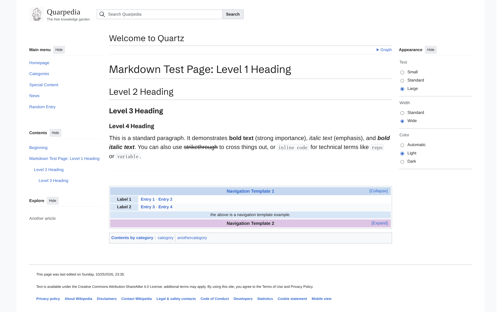

# Quartz Vector 2022 Skin

基于 [wikimedia/mediawiki-skins-Vector](https://github.com/wikimedia/mediawiki-skins-Vector) 二次开发的仿 Wikipedia Quartz 布局插件：顶部搜索、可移入侧栏的菜单、文章目录、外观设置、条目信息框，以及文章底部的导航模板和分类栏。



皮肤适用于 Quartz 5 社区插件系统。中文、英文界面都可以使用，手机上也能阅读。它主要负责页面外观；账户、在线编辑、页面历史等 MediaWiki 后台功能，需要另外实现。

## 一行安装

需要 Node.js 22 或更新版本、npm 10.9.2 或更新版本。在支持社区插件的 Quartz 5 站点根目录运行：

```sh
npx quartz plugin add github:Copartiper/quartz-skin-vector-2022
```

命令会下载、构建插件，并在 `quartz.config.yaml` 中添加启用记录。再运行 `npx quartz build --serve`，就可以预览。无需复制布局文件，也不用修改 `quartz.ts`。

插件面向标准 Quartz 5 页面布局；如果使用的是没有 `quartz plugin` 命令的旧版 Quartz，需要先升级。完全重写页面结构的自定义主题，需要另行接入组件。

安装后，找到配置中这个插件的条目，把设置写在它的 `options` 下面：

```yaml
plugins:
  - source: github:Copartiper/quartz-skin-vector-2022
    enabled: true
    options:
      tagline: 记录、连接、分享
```

保留站点原有的其他插件条目，只修改这一项。下面的例子都采用相同写法，不要重复添加插件。

默认主菜单只提供首页和分类索引，你可以按需添加站点自己的栏目。皮肤会复用站点已有的搜索、探索和图谱；缺少某个组件时，对应入口会隐藏。阅读时长、路径导航、原生主题按钮和 Properties 栏会在皮肤布局中隐藏，分类移到正文底部，其他侧栏组件移到正文下方。没有配置新页脚时，会保留原来的页脚内容。

这些调整在页面加载时完成，需要启用 JavaScript。插件不会改写其他插件的开关，也不会修改文章；将它的 `enabled` 改为 `false` 并重新构建，就能恢复原布局。

## 换站名、标志和主菜单

下面这些设置都写在 `quartz.config.yaml` 中本插件的 `options` 下。安装时已经生成条目，找到它修改即可。

```yaml
plugins:
  - source: github:Copartiper/quartz-skin-vector-2022
    enabled: true
    options:
      locale: zh-CN
      wordmark: 我的知识库
      tagline: 记录、连接、分享
      logoUrl: static/icon.png
      logoAlt: 我的知识库标志
      navigation:
        - label: 首页
          href: index
        - label: 分类索引
          href: tags/
        - section: 参与
          label: 关于本站
          href: about
```

`wordmark` 是顶部站名；不填就使用 Quartz 的 `pageTitle`。`tagline` 是下面的小字。`logoUrl` 是标志图片的路径，留空就不显示图片。

主菜单里，一项就是一个链接：`label` 写显示名称，`href` 写目标页面。加上 `section`，会在这一项前面显示分组标题。提供 `navigation` 后，会替换整个默认菜单，所以首页也要自己写进去。写成 `navigation: []` 则会清空菜单。

链接一般写成 `about` 或 `notes/example`，不用加 `.md`。这种路径从站点根目录开始找，放在不同层级的文章里也能指向同一页。外部链接直接写完整的 `https://...` 地址。菜单不会自动创建页面，请确认目标文章已经存在。

## 调整菜单和阅读外观

主菜单、目录、探索都可以「移至侧栏」，也可以点「隐藏」放回按钮里。左侧从上到下是主菜单、目录、探索。外观面板固定在右侧，隐藏后通过右上角的眼镜按钮打开。

桌面端的「标准」宽度会保留两侧空间，所以隐藏菜单不会让正文突然左右移动；「宽」会把空侧栏的位置交给正文。页面窄于 1120 px 时，四个菜单都改用按钮打开，并取消侧栏留白。没有分节的文章不显示目录；目录入口滚出屏幕后，左上角会出现悬浮目录按钮。

你可以设置访客第一次打开网站时的阅读外观：

```yaml
plugins:
  - source: github:Copartiper/quartz-skin-vector-2022
    enabled: true
    options:
      defaultTheme: auto # auto 跟随系统，也可以填 light 或 dark
      defaultTextSize: standard # small、standard 或 large
      defaultWidth: standard # standard 或 wide
      showAppearance: true
```

浏览器会记住访客自己的选择，之后优先使用这些选择。因此，改了默认设置却没看到变化时，可以先检查浏览器里是否已经选过其他设置。

顶部搜索先给出匹配标题或描述的候选。想搜正文时，点击候选框底部的「搜索包含……的页面」，就会打开 Quartz 原来的全文搜索和页面预览。搜索词会加粗显示，链接预览和搜索预览中会隐藏网站页头，只保留文章内容。

### 阅读时的目录与宽度

目录按文章标题的层级排列，可以用小箭头展开、收起子节。章节不超过 28 个时默认展开；更多时先收起子节，方便快速浏览整篇文章的结构。打开指向子节的链接时会展开它的父节，滚动阅读只更新当前位置的提示，不会反复替你展开、收起目录。没有分节的文章不显示目录。

「标准」宽度限制页面宽度并保留左右栏位，隐藏菜单时正文保持原位。「宽」会让页面铺满浏览器，并把没有固定菜单的侧栏空间交给正文。站点可以用 `defaultWidth: standard` / `wide` 设置初始值，读者已保存的选择优先。

右下角是「页面最顶」和「页面最底」两个圆形按钮。向下滚动且文章标题已经离开视野时出现，向上滚动或回到标题处时隐藏。点击后直接跳到整页顶部或底部，手机上也可使用。

菜单可以按 Escape 关闭，焦点会回到打开它的按钮；同一时间只展开一个浮动菜单。搜索候选支持方向键选择，选中的项目会自动滚到可见位置。

这些细节参考了 MediaWiki 的[桌面版改进](https://www.mediawiki.org/wiki/Reading/Web/Desktop_Improvements/zh)、[更新记录](https://www.mediawiki.org/wiki/Reading/Web/Desktop_Improvements/Updates/zh)和 [Vector 2022 设计说明](https://www.mediawiki.org/wiki/Skin:Vector/2022/Design_documentation)，并结合 Quartz 的文章和搜索功能调整。

## 写页脚

页脚正文用 Markdown 写，和平时写文章差不多。链接列表单独放在 `footerLinks` 中：

```yaml
plugins:
  - source: github:Copartiper/quartz-skin-vector-2022
    enabled: true
    options:
      revisionTimeZone: Asia/Shanghai
      footerMarkdown: |
        本站文字按 **[许可协议](https://example.org/license)** 提供。

        继续使用本站前，请阅读[使用条款](usage)。
      footerLinks:
        - label: 关于本站
          href: about
        - label: 联系方式
          href: contact
```

正文颜色和链接颜色默认跟随文章配色，页脚没有单独的纯色背景。修订时间显示在页脚正文上方，使用文章最近一次 Git 提交的时间；文章尚未提交时，使用本地文件修改时间。

需要单独指定页脚文字颜色时，可以加上：

```yaml
footerTextColors:
  light: "var(--qv-fg)"
  dark: "var(--qv-fg)"
```

这里可以填十六进制颜色，也可以使用 `var(--变量名)`。`var(--qv-fg)` 就是正文文字颜色。旧配置 `footerParagraphs` 仍然可用，但同时写了 `footerMarkdown` 时，以 Markdown 为准。

## 给文章加信息框（Infobox）

人物、地点或组织条目经常需要一张资料卡。在文章开头的 YAML 中加上 `infobox` 即可；没有配置的文章不会显示。电脑上正文会环绕信息框，手机上则把它放在正文开头。

```yaml
---
title: 示例组织
infobox:
  title: 示例组织
  subtitle: Example Organization
  image: static/icon.png
  imageAlt: 组织标志
  caption: 组织标志与名称
  color:
    light: "#c5d8ef"
    dark: "#293e57"
  rows:
    - heading: 基本资料
    - label: 类型
      content: 知识共享组织
    - label: 所在地
      content: "[示例城市](places/example)"
    - heading: 更多信息
    - label: 理念
      content: "**开放 · 普惠 · 共享**"
  below: "参阅[相关条目](related)"
---
```

`title` 和 `rows` 必填，其余都可以省略。每一行可以写 `heading` 作为分组标题，或者写 `label` 和 `content` 作为字段和值。标题、副标题、图片说明、字段和底部备注都支持行内 Markdown，原始 HTML 会被转义。图片及 Markdown 链接中的普通相对路径从站点根目录解析；也可以填写完整的 HTTPS 地址。图片没有说明性内容时可以省略 `imageAlt`，否则建议写清楚图片是什么。`color.light` 和 `color.dark` 接受十六进制颜色，控制对应主题下的分组背景。

使用手动布局 API 的站点，可以将导出的 `VectorInfobox()` 放到文章正文开头；标准插件安装会自动放好位置。

## 给文章加导航模板

导航模板就是文章底部那块分组链接。比如「入门指南」模板，可以把简介、安装说明、常见问题放在一起。

最常用的方式是：**全站写一份模板，多篇文章一起引用。**

先在插件的 `options` 下写模板：

```yaml
plugins:
  - source: github:Copartiper/quartz-skin-vector-2022
    enabled: true
    options:
      navigationTemplates:
        - title: "[我的知识库](index)"
          collapsed: false
          color:
            light: "#c5d8ef"
            dark: "#293e57"
          rows:
            - label: 入门
              content: "[简介](about) · [使用方法](guide)"
            - label: 相关页面
              content: "[常见问题](faq) · [联系方式](contact)"
          below: "[分类索引](tags/)"
```

再到要显示它的文章里，加上 `navboxes`：

```markdown
---
title: 使用方法
navboxes: [0]
---

这里是文章正文。
```

`0` 表示配置里的第一个模板，`1` 表示第二个。写成 `navboxes: [0, 1]`，就会按这个顺序显示两个模板。不写 `navboxes` 的文章不会出现模板。

模板里这些字段可以这样理解：

| 字段             | 写什么                                      |
| ---------------- | ------------------------------------------- |
| `title`          | 模板标题，可以带链接                        |
| `collapsed`      | `true` 表示默认收起，`false` 表示默认展开   |
| `color.light`    | 浅色主题下的标题背景色，例如 `"#c5d8ef"`    |
| `color.dark`     | 深色主题下的标题背景色，例如 `"#293e57"`    |
| `rows`           | 每个分组的名称 `label` 和链接内容 `content` |
| `above`、`below` | 分组上方、下方的补充内容，可省略            |
| `links`          | 可选的操作链接，每项填写 `label` 和 `href`  |

分组底色会从标题颜色自动生成，不需要逐块调色。不填颜色时使用默认配色。文字内容支持行内 Markdown；链接指向当前文章时，会自动变成加粗的纯文本，避免点回自己。

只在一篇文章里使用的模板，也可以直接写在文章属性中。完整示例见 [EXAMPLES.md](EXAMPLES.md)。

## 底部的分类从哪里来？

分类沿用 Quartz 原来的标签。文章开头这样写：

```yaml
---
title: 示例文章
tags:
  - 知识
  - 入门
---
```

站点会把它显示成文章底部的「分类：知识｜入门」。没有标签时，分类栏也会隐藏。

## 更新、禁用和迁移

更新到 GitHub 上的新版本：

```sh
npx quartz plugin update quartz-skin-vector-2022
```

更新后重新构建网站。建议先保存自己的配置和文章修改，再更新插件。

暂时不用皮肤时，把插件条目的 `enabled` 改成 `false`，然后重新构建即可。配置和文章里的导航模板定义都可以保留，之后再启用时继续使用。

如果你以前手动接入过这个插件，需要先移除 `quartz.ts` 或布局文件里重复插入的 Vector 组件及搜索索引，再使用自动接入版。把旧 `vectorSkin` 区块里的设置移到插件条目的 `options` 下；新版不会自动读取旧区块，也不会覆盖你的布局文件。

## 想自己安排布局？

自动接入使用 `VectorPage`，它会把整套皮肤放进标准 Quartz 页面。想自行控制每一块的位置，也可以继续使用 `VectorSkin(options)` 创建组件：

| 返回的组件   | 用途                                       |
| ------------ | ------------------------------------------ |
| `header`     | 顶部栏，同时加载样式和浏览器脚本，每页一次 |
| `toc`        | 文章目录，需要 Quartz 提供目录数据         |
| `appearance` | 外观面板                                   |
| `navigation` | 正文底部的导航模板                         |
| `revision`   | 读取 `dates.modified`，显示修订时间        |
| `footer`     | Markdown 页脚和链接列表                    |

这些组件也可以单独导入。手动接入时，还需要自行安排搜索、分类栏等布局，并将 `VectorSearchIndex()` 加入发射器列表。不要同时加载手动组件和自动接入的 `VectorPage`。代码位置和开发方式见 [ARCHITECTURE.md](ARCHITECTURE.md)。

## 开发和检查

```sh
npm run check        # 类型、代码风格和单元测试
npm run build        # 构建插件
npx playwright install chromium # 首次运行浏览器测试前安装
npm run test:browser # 检查布局与交互
# 用本机已安装依赖的 Quartz 5 验证原生安装、配置、页面切换和禁用：
QUARTZ_HOST=/path/to/quartz npm run test:install
```

浏览器测试会在系统临时目录的 `quartz-vector-preview/` 中留下预览和截图。安装测试另外创建独立站点，并复制插件源码供安装器构建，不会修改所提供的 Quartz 站点。安装到自己的站点后，仍建议构建并查看页面。

### 性能检查

运行 `npm run test:performance` 可以测量 100 页首次渲染与缓存后重复渲染的耗时，并统计 Git 进程数。`npm run test:browser` 还会检查长目录滚动的标题位置读取次数，以及布局变化后的高亮是否正确。具体结果和适用范围见 [性能记录](PERFORMANCE.md)。

## 来源和许可证

布局参考 MediaWiki 的 Vector 2022，并改写为 Quartz 使用的 Preact、SCSS 和浏览器脚本。项目以 **GPL-2.0-or-later** 发布，详见 [LICENSE](LICENSE)、[LICENSE.Vector](LICENSE.Vector) 和 [NOTICE](NOTICE)。原插件模板的 MIT 许可证保留在 [LICENSE.template](LICENSE.template)。

这是独立移植项目，不代表 Wikimedia 或 Quartz 官方，也不附带 Wikipedia 标志。
